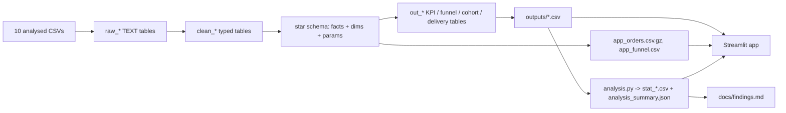

# 01. Architecture

## Stack
SQLite (Python stdlib `sqlite3`, single file kept outside OneDrive) | Python: pandas, numpy, scipy, plotly, streamlit, pytest | Git/GitHub | Streamlit Community Cloud.
(Earlier drafts said DuckDB/parquet; replaced, see decision D-015.)

## Repository layout
```
EcommerceRCA/
  AGENTS.md                      entry point for the implementation agent
  README.md                      (WP4)
  requirements.txt
  .gitignore
  data/raw/
    EcommercePub dataset/        9 e-commerce CSVs (git-ignored; folder names contain spaces)
    Marketing funnel/            2 funnel CSVs (git-ignored)
  sql/
    01_load_clean.sql            raw_* (TEXT) -> typed clean_* tables + out_clean_log
    02_star_schema.sql           params, facts, dimensions, flags
    03_kpis.sql                  out_kpi_monthly / overall / seller
    04_funnel.sql                waterfall + conversion cuts (origin, landing page, month, segment, lead type, SDR)
    05_cohorts.sql               seller retention cohorts
    06_delivery_reviews.sql      stage decomposition, review by delay band, state/lane/category, dispatch compliance, sensitivity
  src/
    audit.py                     Phase A audit (pandas)
    run_pipeline.py              CSV -> SQLite -> out_* CSVs -> analysis
    analysis.py                  statistics layer -> stat_*.csv, analysis_summary.json
    stats.py                     Wilson CI, Mann-Whitney, bootstrap, chi-square, Mantel-Haenszel
    simulator.py                 what-if scenario logic
    robustness.py                (WP1)
  outputs/                       CSV / CSV.GZ / JSON consumed by the app (committed except audit)
  app/
    Home.py  data.py  ui.py
    pages/                       one file per page
    .streamlit/config.toml
  tests/                         pytest + Streamlit AppTest
  docs/                          planning docs, audit.md, decision_log.md, findings.md (WP2)
```

## Data flow


## Star schema
Facts: `fact_orders` (order_id), `fact_order_items` (order_id + order_item_id), `fact_reviews` (order_id; latest review), `fact_seller_funnel` (mql_id).
Dimensions: `dim_seller`, `dim_customer`, `dim_product` (English category), `dim_date`. Table `params` holds window_start, window_end_excl, data_end_effective.
Geolocation is not loaded into the model (D-014); `dim_geo` was dropped.
Exact grain and flags per table: comments in `sql/02_star_schema.sql` (WP1 turns them into `docs/data_model.md`).

## Design rules
- Raw tables are never altered; every cleaning decision is logged in `docs/decision_log.md` with rows affected.
- Delivery KPIs use delivered orders with a delivery date; lateness is date-level (D-012).
- The deployed app reads only `outputs/` files, never raw CSVs or the database (dataset license believed CC BY-NC-SA 4.0; verify on Kaggle and credit Olist).
- One command rebuilds everything: `python src/run_pipeline.py --raw data/raw --db <path>.sqlite --out outputs`. One command launches the app: `streamlit run app/Home.py`.
