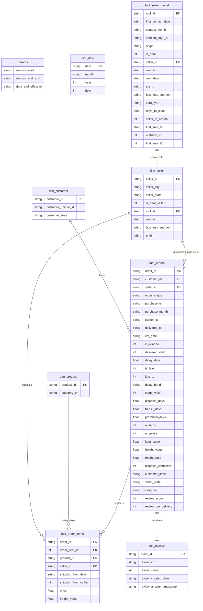

# Data Model Specification

## 1. Schema Overview & Architecture
The analytical layer uses a star schema built in SQLite (`C:\work\olist.sqlite`) from 10 raw CSV datasets. It is designed around four core fact tables and four dimension tables, with analysis parameters defined in a dedicated singleton configuration table.

The architecture strictly decouples grains to avoid the **fan-out trap**: joining marketing leads directly to order items produces 12,664 rows from 8,000 leads (V-004). Money, orders, sellers, and leads are aggregated at their respective distinct grains.

---

## 2. Table Grains & Descriptions

| Table Name | Grain | Primary / Natural Key | Description | Governing Decisions |
|---|---|---|---|---|
| `params` | Singleton (1 row) | N/A | Analysis window parameters (`window_start`, `window_end_excl`, `data_end_effective`). | D-011, D-013 |
| `dim_customer` | 1 row per customer | `customer_id` | Customer geographical attributes (`customer_state`) and unique identifier. | Star schema spec |
| `dim_seller` | 1 row per seller | `seller_id` | Seller location and marketing acquisition attributes (`is_deal_seller`, `mql_id`, `business_segment`, `origin`). | D-008, D-014 |
| `dim_product` | 1 row per product | `product_id` | Product category translated to English (`category_en`). | D-019 |
| `dim_date` | 1 row per calendar date | `date` | Calendar dimension spanning the full analysis window (`2017-01-01` to `2018-08-31`). | D-011 |
| `fact_orders` | 1 row per order | `order_id` | Primary fact table capturing order lifecycle timestamps, delivery lateness, stage durations, GMV, and single-seller attribution. | D-002, D-004, D-011, D-012, D-018, D-019, D-020, D-021 |
| `fact_order_items` | 1 row per order item | `(order_id, order_item_id)` | Line-item detail containing item price, freight value, product, seller, and shipping limit dates. | D-005, D-009 |
| `fact_reviews` | 1 row per order | `order_id` | Deduplicated customer review score and creation dates (latest review by answer timestamp). | D-003, D-021 |
| `fact_seller_funnel` | 1 row per marketing lead | `mql_id` | Marketing funnel lifecycle: lead contact, deal close, days to close, SDR attribution, and 90-day downstream sales activity. | D-007, D-016, D-026 |

---

## 3. Key Relationships

1. **`fact_orders` to `dim_customer`** (N:1):
   - `fact_orders.customer_id = dim_customer.customer_id`
   - Every order maps to exactly one customer and customer state.

2. **`fact_orders` to `dim_seller`** (N:1, conditional):
   - `fact_orders.seller_id = dim_seller.seller_id`
   - Populated only for **single-seller orders** (`n_sellers = 1`). Multi-seller orders leave `seller_id = NULL` to avoid false attribution of delivery performance (D-018).

3. **`fact_orders` to `fact_order_items`** (1:N):
   - `fact_orders.order_id = fact_order_items.order_id`
   - Item monetary sums (`item_value = SUM(price)`) and freight values are aggregated up to `fact_orders` without row duplication (D-009).

4. **`fact_order_items` to `dim_seller`** (N:1):
   - `fact_order_items.seller_id = dim_seller.seller_id`
   - Enables seller-level item counts, revenue, and multi-seller order participation (D-025).

5. **`fact_order_items` to `dim_product`** (N:1):
   - `fact_order_items.product_id = dim_product.product_id`
   - Maps line items to product English categories. Item 1 defines the order's primary category (D-019).

6. **`fact_orders` to `fact_reviews`** (1:1 / 1:0):
   - `fact_orders.order_id = fact_reviews.order_id`
   - Enforces strict 1-review-per-order deduplication (D-003).

7. **`fact_seller_funnel` to `dim_seller`** (1:1 / 1:0):
   - `fact_seller_funnel.seller_id = dim_seller.seller_id`
   - Links marketing closed deals to sellers observed in the order catalog (380 deal sellers linked, 376 with delivered orders; V-002).

8. **`fact_orders` to `dim_date`** (N:1):
   - `date(fact_orders.purchase_ts) = dim_date.date`
   - Provides calendar slicing within the analysis window.

---

## 4. Entity-Relationship Diagram (Mermaid)

A visual rendering of the schema diagram is saved as `docs/erd.png`.
